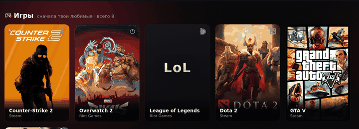
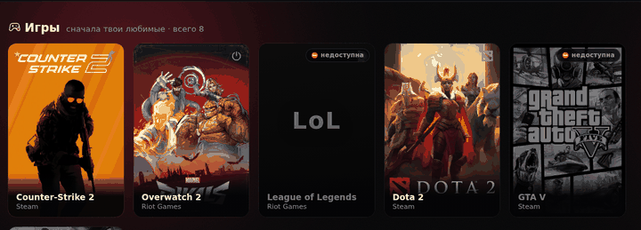
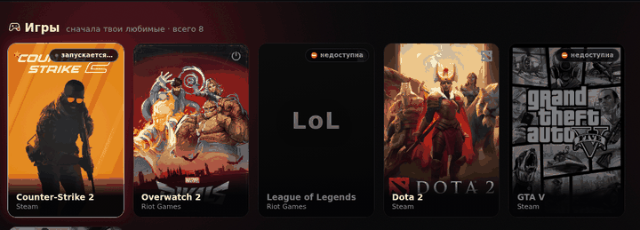
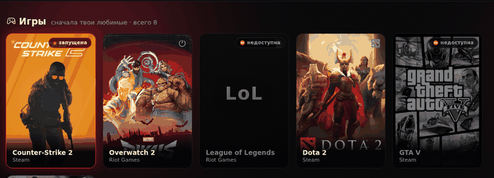

# Витрина игр на гостевом экране (пакет 3)

Файл: `web/shell.html`. Миграций нет, бэкенд не трогали.
Смежные пакеты: **1** — каталог и `cover_url` (`backend/cmd/server/catalog.go`, `web/admin.html`),
**2** — агент и `GET /apps-status` (`backend/cmd/agent/*`).

## Что было не так

Плитка выглядела одинаково независимо от того, установлена ли игра на этом ПК,
доступен ли сетевой диск и жив ли агент. После клика гость видел тост
«🚀 Запускаю…» — и на этом всё: `startDetached()` в агенте отвечал успехом даже
на несуществующий путь. В пилотном клубе игры лежат на TrueNAS, поэтому
«путь недоступен» — это будни, а не редкость.

## Что теперь

### 1. Доступность игры видно до клика

Шелл опрашивает у агента `GET http://127.0.0.1:1448/apps-status`:

```json
{"apps": {"cs2": {"available": true},
          "gta5": {"available": false, "reason": "path_unreachable"}},
 "running": {"app_id": "cs2", "pid": 1234, "since": "2026-08-27T15:00:00Z"}}
```

Недоступная игра — обесцвеченная обложка, приглушённое имя и подпись
**«недоступна»** прямо на плитке. Клик по ней больше не врёт «Запускаю…», а
объясняет причину человеческим языком:

| `reason` от агента | что видит гость |
|---|---|
| `path_unreachable` | «диск с играми сейчас недоступен. Позови админа — он подключит» |
| `target_missing` / `not_installed` | «не установлена на этом ПК» |
| `not_allowed` / `not_in_allowlist` | «не разрешена на этом ПК» |
| любой другой / отсутствует | «сейчас недоступна на этом ПК» |

**Ритм опроса** (без спама, всё на localhost):

| ситуация | интервал |
|---|---|
| покой | 20 с |
| ждём запуск после клика | 2.5 с, не дольше минуты |
| эндпоинта ещё нет (404/501) | 5 мин |
| агент не отвечает на `/ping` | не ходим вообще |

**Совместимость со старым агентом — главное требование.** Пока пакет 2 не
выкачен, `/apps-status` отдаёт 404: шелл гасит все состояния (`appsStatus = null`)
и ведёт себя ровно как до пакета 3 — те же плитки, тот же тост «Запускаю…».
Раз в 5 минут переспрашивает, чтобы подхватить обновлённого агента прямо в смену.
Любая сетевая ошибка проглатывается молча: витрина не должна падать из-за агента.

### 2. Состояние запуска — на плитке, а не только в тосте

```
клик → «запускается…»  (светлая рамка, пульсирующая точка)
     → «● запущена»    (красная рамка + свечение) — по факту процесса в /apps-status
```

* Повторный клик по **запускающейся** — «уже запускается — подожди», второго запуска нет.
* Повторный клик по **запущенной** — «уже запущена на этом ПК», второго запуска нет.
* Агент вернул `409 already_running` — плитка сразу переходит в «запущена».
* Агент вернул `target_missing` / `path_unreachable` в ответе на `/launch` — плитка
  гаснет немедленно, не дожидаясь следующего опроса.
* **Таймаут 45 с.** Процесс не появился: состояние снимается, и если `/apps-status`
  живой — честное «⚠ не подтвердила запуск, позови админа». Со старым агентом
  подтверждать нечем, поэтому там плитка гаснет молча.

Состояния перекрашиваются точечно (`paintAppStates`), без полной перерисовки
витрины — иначе анимация появления плиток дёргалась бы каждые 20 секунд.

Те же три состояния работают и на плитках приложений/системы, и на карточке
клиента платформы внутри папки.

### 3. Обложки — из каталога, файл остался фолбэком

Приоритет: `cover_url` из строки каталога → локальный `web/covers/<id>.jpg` →
градиент с крупным тегом (как раньше).

`const COVERS` никуда не делся — это список файлов, которые лежат в репозитории;
он продолжает работать для клубов, где владелец обложку ещё не задал, и для
браузерного демо. Адрес из БД экранируется перед подстановкой в `style` —
обложку задаёт владелец через админку, и кавычка в URL не должна ломать атрибут.

### 4. Судьба встроенного фолбэк-каталога

**Решение: оставить, но сузить до демо и не показывать на клубном ПК.**

Что сделано:

1. `FALLBACK_CATALOG` → **`DEMO_CATALOG`**, с заголовком «это НЕ каталог клуба».
2. Список сокращён: 10 игр → 6, 5 платформ → 3, 5 приложений → 3. Системные
   настройки (`Звук`/`Мышь`/`Дисплей`/`NVIDIA`) остались целиком — они открываются
   протоколом `ms-settings:` прямо из браузера и одинаковы на любом Windows-ПК.
   Оставшийся набор проходит по всем веткам отрисовки: обложка из файла (CS2,
   Dota 2, GTA V, Apex), градиент с тегом (Valorant, Fortnite), карточка клиента
   платформы, папки приложений.
3. Когда демо всё-таки на экране — в шапке «Игры» висит чип **«демо-каталог»**.
4. **На клубном ПК демо не показывается.** Признак «настоящий ПК» — нативный
   киоск WebView2 или живой агент. Если сервер не отдал каталог, гость видит
   заглушку «Каталог клуба сейчас недоступен», а шелл раз в минуту переспрашивает
   сервер и наполняет витрину, как только тот поднимется.

Почему не «убрать совсем»: без агента и без сервера `shell.html` — это единственная
витрина для показа и разработки (демо-стенд Railway, открытый локально файл).
Пустой экран там сломал бы демо.

Почему не «оставить как было»: 10 игр из встроенного списка на клубном ПК — это
ровно то враньё, ради которого затевался пакет: гость жмёт игру, которой в клубе
нет. Список из 6 позиций к тому же дешевле поддерживать в синхроне.

## Что нужно от пакета 2 (агент)

Контракт зафиксирован в `docs/ПРОМПТЫ-ИГРЫ.md`; шелл рассчитывает на:

* `GET /apps-status` → `{"apps": {"<id>": {"available": bool, "reason": "..."}}, "running": {...}|null}`.
  Пока эндпоинта нет — **404 или 501**, не 500 и не таймаут.
* `running` — `null` либо объект с непустым `app_id`.
* `POST /launch` → `200 {ok, pid, state}`; `state:"running"` или код `already_running`
  означают «уже запущено». Ошибки — с кодами `target_missing`, `path_unreachable`,
  `launch_failed`; `404` по-прежнему значит «нет в allowlist» и роняет шелл в
  браузерный фолбэк (протокол/URL).
* CORS: шелл открыт с `http(s)://…`, агент на `127.0.0.1:1448` — нужен
  `Access-Control-Allow-Origin`, иначе `fetch` не дойдёт.
* `reason` желательно из списка выше — незнакомый код не сломает экран, но гость
  получит общую формулировку.

## Локализация

Добавлено 14 ключей во все три словаря (`SH_RU` / `SH_EN` / `SH_PL`), по 415 ключей
в каждом, наборы совпадают:
`st_unavail`, `st_launching`, `st_running`, `launch_wait`, `launch_started`,
`launch_running`, `launch_noconfirm`, `na_path_unreachable`, `na_target_missing`,
`na_not_allowed`, `na_default`, `cat_demo`, `cat_offline`, `cat_offline_hint`.

## Состояния на экране

| доступна | недоступна |
|---|---|
|  |  |

| запускается | запущена |
|---|---|
|  |  |

## Как проверить без клуба

Рецепт (он же в памяти проекта, `1448-repo-location.md`): `playwright-core` +
системный Chromium + мок-сервер на `node http`. Мок поднимает два порта: `:8080` —
статика `web/` и `/api/v1/*`, `:1448` — агент (`/ping`, `/apps-status`, `/launch`)
с CORS и ручкой `POST /__set`, которой тест на ходу меняет доступность,
`running` и «сборку» агента (`statusSupported`, `legacyLaunch`).

Прогнано 41 проверок, ошибок JS и консоли — 0:

* доступна / недоступна / запускается / запущена — классы, подписи, тосты;
* обложка из `cover_url` перебивает локальный файл; без обложки — градиент;
* клик по недоступной не переводит плитку в «запускается» и не врёт «Запускаю»;
* повторный клик по запускающейся и по запущенной — без второго запуска;
* таймаут 45 с снимает состояние и объясняет, что запуск не подтвердился;
* **старый агент** (нет `/apps-status`, тупой `/launch`) — витрина цела,
  бейджей нет, клик работает как до пакета 3;
* агент упал посреди сессии — состояния сброшены, экран жив;
* нет сервера и нет агента — демо-каталог с чипом;
* нет сервера, но агент жив — заглушка «каталог недоступен», чужих игр нет;
* вьюпорт 390×844 — состояния читаются (сама раскладка `shell.html` на телефон
  не рассчитана: это экран клубного ПК, мобилка — отдельный `web/app.html`,
  трек М; на HEAD она ломается так же).

## Правки файла

`web/shell.html`: 346 347 → 363 481 байт, 20 точечных замен, каждая сработала
ровно один раз. База бралась из `git show HEAD:web/shell.html`, файл с маунта не
читался (кэш врёт — см. память проекта).
